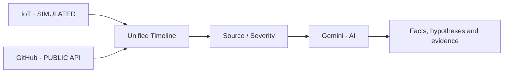

# OpsReplay — Hackathon Demo

Prepared: 28 October 2026.

## 1. OpsReplay: one timeline for investigating device incidents

**Our idea:** combine device records and software activity, then help people review them with AI that cites the evidence.

**A device suddenly goes offline. What happened before it?**

For this hackathon, we combine **simulated IoT**, the **public GitHub API**, and **Gemini** in one prototype. The focus is investigation support, with a person making the decision.

## 2. Imagine a small IT team supporting a retail business.

The business uses connected devices in its operations. One day, a device is reported offline.

The team needs to inspect device records and software changes. The records are in different places, while the people handling them are limited.

**Their question:** is the device faulty, is connectivity involved, or is there another change to check?

This is an illustrative small-to-medium-business scenario, not customer data or interview findings. No retail company is connected to the prototype.

## 3. Separate records make an incident harder to reconstruct.

| Question | Records to inspect |
| --- | --- |
| What symptoms did the device show? | Readings, status and event times |
| What changed in the software? | Commits, pull requests and workflow activity |
| What can we conclude? | Supporting evidence and missing information |

A real example: Square reported a September 2023 outage that disrupted payment services for sellers. Its report shows how technical disruption can interrupt business operations. [S5]

OpsReplay has not been tested on the Square case and has no payment integration. That case provides problem context, not proof that this prototype could resolve it.

## 4. Existing approaches already help with investigation.

| Approach | What it helps with |
| --- | --- |
| Reviewing records manually | People can read each source and reconstruct the sequence themselves |
| PagerDuty Recent Changes [S2] | Brings recent changes into incident context |
| Datadog Bits Investigation [S3] | Supports investigation with AI and operational context |

We do not claim a new category or superiority over these products. In this hackathon, we test a small investigation flow connecting device and software evidence, with visible sources and boundaries.

This comparison uses official documentation, not hands-on competitor testing.

## 5. Our approach: combine, focus, then check.

1. **Unified Timeline:** view device events alongside public GitHub activity.
2. **Source / Severity:** narrow the events to inspect.
3. **Investigate with AI:** request a summary and possible explanations.
4. **Evidence chips:** return to the records behind the answer.

The timeline provides context. Filters define the input. Evidence references make the answer reviewable. Events close in time do not automatically establish causation.

## 6. What we implemented for this hackathon.

| Part | Prototype implementation |
| --- | --- |
| IoT | A deterministic smart-plug simulator with readings and offline/online events |
| Public API | Read-only commits, PRs and workflows from a public GitHub repository |
| Interface | Unified Timeline, Source labels, Severity filters and original timestamps |
| AI | Gemini returns Observed facts and Hypotheses (unconfirmed) with event references |
| Checks | Server-side response/evidence-ID validation, a feature gate and Redis quota |

Device input is simulated. Physical hardware adapters, app user accounts, multi-site inventory and automatic remediation are not implemented. The successful live AI test used a protected Preview.

## 7. Demo scenario: one device, three important events.

**Setup:** Source = IoT · Severity = Critical · Demo Time Alignment = OFF.

All visible events after filtering become the AI input. Here, the input contains two power readings and an offline status from sim-plug-01.

**Investigation question:** what do these three records show, what explanations remain possible, and what evidence is missing?

This is the SIMULATED input used in the completed successful UI test. It contained no GitHub events. GitHub integration is present in the timeline, but this run did not verify mixed-source AI behavior.

## 8. Test result: a displayed answer with traceable references.

**Observed facts:** two power readings and an offline status, with SIMULATED evidence chips.

**Hypotheses (unconfirmed):** Device failure or loss of connectivity — **low confidence**, **not a confirmed root cause**.

| Evidence from one completed request | Result |
| --- | --- |
| Input / outcome | 3 simulated events / result successfully displayed |
| Provider | HTTP 200 / 1 attempt |
| Gemini stage | 1.623 s; not total browser latency or a benchmark average |

The owner's screenshot and deployment log support this one working path. Valid event references do not automatically make the interpretation correct or prove the cause.

## 9. What have we shown, and what remains open?

**Demonstrated:** simulated events → filters → AI → a result with event references worked for one bounded scenario. Public GitHub activity can appear in the same timeline.

**Not established:** real-device integration, diagnosis across many cases, reduced incident-resolution time or superiority over other products. Production AI remains OFF.

**Next:** a real-device adapter, same-case evaluation across manual/timeline/AI, and recorded incidents that can be replayed. A 3D map is an option after site/device data exists; it is not a current website feature.

**What we want to demonstrate:** separate records can become one investigation flow that a person can inspect.

## Sources — checked 28 October 2026

- [S2 · PagerDuty — Recent Changes](https://docs.pagerduty.com/ai-automation/aiops/recent-changes) — Documented change-event context; not a hands-on comparison.
- [S3 · Datadog — Bits Investigation](https://www.datadoghq.com/blog/bits-ai-sre/) — Vendor description of AI-assisted investigation; no competitive performance result.
- [S5 · Square Engineering — Incident Summary: 2023-09-07](https://developer.squareup.com/blog/incident-summary-2023-09-07/) — Published 15 September 2023. A real service outage affecting sellers; not an OpsReplay case or proof that fragmented records caused the outage.
