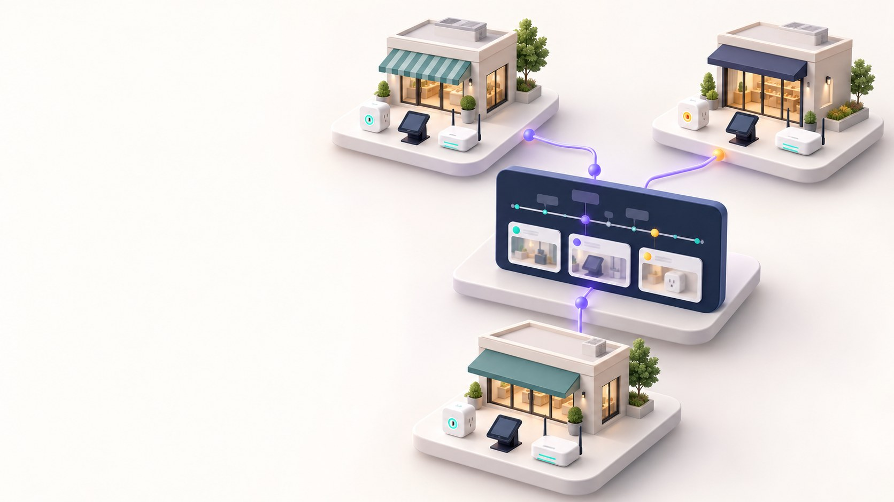

# OpsReplay — Pilot Pitch

Prepared: 28 October 2026. Proposed retail pilot; not a production offer.

## 1. A branch device stops working. Where do you look first?

OpsReplay brings device records and software activity into one timeline, so a team can check the evidence before deciding what to do.

**Proposed first use case:** teams supporting devices across retail branches.

Current stage: working prototype with simulated device data. The multi-branch scene is a future concept, not a live customer system.

## 2. A software problem can become an operations problem.

**8.5 million Windows devices**

Microsoft's estimate of devices affected by the 2024 CrowdStrike update incident. [S1]

For a team running connected equipment, an outage can mean interrupted work and time spent checking several systems. This is why the evidence matters.

The historical incident shows the scale of software-to-device risk. It does not show that OpsReplay could have prevented or resolved it.

## 3. Useful tools already exist. We should learn from them.

| Approach | What it helps with |
| --- | --- |
| PagerDuty Recent Changes [S2] | Brings recent service changes into incident triage |
| Datadog Bits Investigation [S3] | Uses operational context to investigate issues with AI |
| OpsReplay prototype | Combines simulated device events and public GitHub activity, with a small, inspectable AI workflow |

Our proposed focus is a clear device-to-software investigation flow for a small pilot. Customer fit is still to be tested; we have not proved a price or performance advantage.

## 4. Put the records together. Make the answer checkable.

1. **Unified Timeline:** see device records and public software activity together.
2. **Source / Severity:** choose the events to inspect.
3. **Investigate with AI:** ask for a summary and possible explanations.
4. **Evidence chips:** return to the records behind the answer.

The operator stays in control. A nearby software change is a clue to inspect, not automatic proof of the cause.

## 5. The core workflow has worked in a protected demo.

| Completed test | Observed result |
| --- | --- |
| Input | 3 SIMULATED device events: two power readings and an offline status |
| AI response | HTTP 200; 1 provider attempt |
| Gemini stage | 1.623 s for this one request |

The UI showed **Observed facts**, **Hypotheses (unconfirmed)** and event references. The displayed hypothesis had **low confidence** and was **not a confirmed root cause**.

This test contained no GitHub events. It proves one working path, not fleet readiness, diagnostic accuracy or faster incident resolution.

## 6. Start with one small pilot, using the customer's problem.

**Example to discuss:** a branch reports an offline device after a software change. The cause could be software, connectivity, power, or something else.

For a pilot, agree on one device type, one approved data source, one software-change source, and a small set of recorded cases.

Deliver a read-only investigation view and a report of what helped, what failed and what is still missing. Real devices, site inventory and deployment-to-device mapping are not connected in the current prototype.

## 7. Measure usefulness before making bigger promises.

Compare the **same cases** in three ways:

| Baseline | Trial modes |
| --- | --- |
| Existing records viewed separately | Unified Timeline, then Unified Timeline with AI |

Measure how long people take to find the relevant records, whether their facts match the input, and whether they make unsupported cause claims. Record AI latency, failed requests and cost separately.

This is a proposed test, not a completed benchmark. No MTTR improvement, accuracy percentage or competitor speed advantage has been measured. [S4]

## 8. Keep the approach adaptable.

| Need | Current starting point / further work |
| --- | --- |
| Different device source | Add a mapper to the shared event format and test it |
| Different alert rules | Change the rule module; check the thresholds with the operator |
| Different AI setup | Gemini model is configurable; another provider needs a new adapter and validation |
| Different business view | Add the site/device context and screens the customer needs |

The parts are separated in code, but a new integration is not automatically plug-and-play. Scope and effort depend on the actual data and requirements.

## 9. A 3D site map could help—when there are many locations.

**Future concept:** select a branch, select a device, then open the same incident records.

A 3D view should help people find the affected place, not just decorate the screen. Keep a simple list/timeline for phones and accessibility.

First we need reliable site/device data. Then compare a 2D list with a 3D view on the same task. Build it into the website only if it helps people find the right device more easily.

## 10. Next: agree on a pilot that can be checked.

1. Choose the team, problem and data they are allowed to share.
2. Agree on the cases and success criteria before the test.
3. Connect only the sources needed for that pilot.
4. Review the results together before deciding what to build next.

**OpsReplay's promise at this stage:** a prototype to test a clearer investigation workflow—not a claim to replace an enterprise platform or automatically fix outages.

Proposed next step: a discovery discussion and a scoped, read-only pilot. Price, schedule and service commitments require requirements review.

### Sources — checked 28 October 2026

- [S1 · Microsoft — Helping our customers through the CrowdStrike outage](https://blogs.microsoft.com/blog/2024/07/20/helping-our-customers-through-the-crowdstrike-outage/) — Published 20 July 2024; estimate of affected Windows devices, not an OpsReplay benchmark.
- [S2 · PagerDuty — Recent Changes](https://docs.pagerduty.com/ai-automation/aiops/recent-changes) — Official product documentation on change events and correlation; no hands-on product trial.
- [S3 · Datadog — Introducing Bits Investigation](https://www.datadoghq.com/blog/bits-ai-sre/) — Vendor description of AI investigation and evidence references; not an independent performance test.
- [S4 · Datadog — Evaluation platform for autonomous SRE agents](https://www.datadoghq.com/blog/engineering/bits-ai-eval-platform/) — Engineering discussion of repeatable scenarios, ground truth and surrounding signals; informs the proposed evaluation design.
