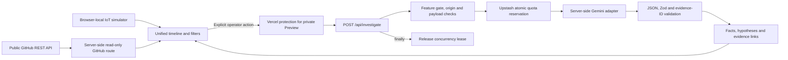

# OpsReplay — Hackathon Demo Pack

Prepared: October 28, 2026. Companion: [self-contained visual guide](HACKATHON_DEMO.html). Open the HTML locally in a browser; use Print / save PDF for a seven-page A4 landscape handout. The guide makes no AI requests and loads no remote assets. This documentation is not an authorization for another AI request or Production activation.

## Product pitch

OpsReplay brings device signals and public software activity into one evidence timeline. An operator can inspect what happened, preserve each source's provenance, and request an AI investigation that separates observed facts from hypotheses and links findings to submitted events.

The hackathon prototype combines a deterministic **simulated IoT** smart plug, the **read-only GitHub public API**, and **server-side Gemini**. It does not control devices, execute remediation, or prove the cause of an incident.

## Start here — no project background needed

Imagine investigating why a smart plug went offline. You want the device readings and recent software activity in one place before guessing what happened. OpsReplay provides that shared timeline, then optionally asks AI to organize observed facts, possible explanations and checks tied to the original records.

- **For a nontechnical reader:** start with the [visual guide](HACKATHON_DEMO.html), pages 1–5. You do not need to run the app to understand the story.
- **For an engineer new to the project:** pages 3, 6 and 7 explain the architecture, request path, limits and remaining release work. Detailed evidence and setup follow below.
- **For a presenter:** use the completed AI result as saved evidence. The previous one-request allowance is consumed; do not click Investigate again while rehearsing or recording.

### Small glossary

| Term | Plain meaning |
| --- | --- |
| Event | One recorded reading, status or software activity, with its time and source. |
| Timeline | Events placed in time order. |
| API | A defined way for one system to ask another system for data or work. |
| IoT simulator | Software-generated device records; this demo has no physical sensor. |
| Hypothesis | A possible explanation that still needs checking. |
| Evidence ID | A reference to an event in the submitted input, not proof that an explanation is true. |
| Preview | A separate deployment used to review the project; the AI Preview requires Vercel login. |
| Quota / lease | A request allowance / temporary slot for a request currently in progress. |

## Verified demo status

| Check | Evidence | Scope |
| --- | --- | --- |
| Offline application checks | [CI 40598088048](https://github.com/lutfim22/opsreplay/actions/runs/40598088048): lint, typecheck, 248 tests across 15 files, normal build passed | Reviewed application tree; mocks are not live-provider evidence |
| Gemini reduced-schema request | [Run 40595678687](https://github.com/lutfim22/opsreplay/actions/runs/40595678687): HTTP 200, one attempt, validation passed | One diagnostic input using `gemini-3.5-flash-lite` |
| Real Redis quota scenarios | [Run 40603979911](https://github.com/lutfim22/opsreplay/actions/runs/40603979911): five scenarios passed, 43 REST requests, cleanup passed | Concurrency/release, minute/day/global denials and expired-lease pruning on the formerly isolated database |
| Protected Preview | Owner checked the new immutable URL in logged-out Incognito and reported that Vercel login was required | Owner-observed access check, not an independently captured HTTP trace |
| Deployed UI investigation | Owner supplied a successful UI screenshot; deployment-scoped runtime log at `2026-10-28T01:11:40.028Z`: status 200, category success, one attempt, three events, 1623 ms | One deployed happy path; provider duration is not total browser latency |
| Evidence presentation | Screenshot shows model provenance, three submitted simulated events, evidence chips, and an explicitly unconfirmed low-confidence hypothesis | Visible portion of the UI, not a full-page accessibility or content audit |

The screenshot identifies generation time `2026-10-28 01:11:40 UTC` and model `gemini-3.5-flash-lite`. The three observations are 1850 W / 230 V, 1720 W / 230 V five seconds later, and the simulated device going offline. No GitHub event was submitted in this first UI investigation.

The successful UI response follows the application's local JSON/Zod and evidence-ID validation path. That validates structure and reference membership; it does not certify the model's interpretation, physical reality, or causal claims. For example, narrative wording about whether a power reading is normal still needs operator review.

## Release and access map

| Purpose | Address / source | Behavior |
| --- | --- | --- |
| Public application | https://opsreplay.vercel.app | AI remains default OFF; public activation has not been authorized |
| Owner's verified AI Preview | https://opsreplay-lkob3nhsu-luthfimusthafa-6881s-projects.vercel.app/timeline | Protected by Vercel login; not an anonymously accessible judging URL |
| Main source | `9485fb6500ae105a8e0192ef33d10ac7a80fbbdb` | Same application tree as the verified Preview |
| Preview source | `aabb69831a94cf748d7f76d1f112aca05b6d39c0` on `codex/isolated-redis-verification` | Exact reviewed Preview source |
| Application tree | `bd52bd079b703365d331a17fcc6e78b53edd7127` | Shared by main, reviewed Preview and passing CI |

Deployment `dpl_3yyA8F3LcPAjAwXgmiCWWAoFGYeo` is the verified Preview. Do not replace the immutable URL with a custom domain as an access workaround: the current SSO policy excludes custom domains. Do not disable protection, share credentials or create bypass links for judges.

## Architecture



Vercel protection surrounds the deployed Preview, including its application routes. The diagram places it beside the investigation path to emphasize the access prerequisite. The application does not implement its own user authentication. Origin checks are not authentication.

The Gemini key and Redis credentials stay on the server. The API submits original event timestamps; display-only Demo Time Alignment does not rewrite evidence. Redis is a shared quota store, not a persisted incident or event database.

## Two-to-three-minute presentation

Use the existing successful screenshot or a recording for the AI segment. The approved one-request UI test has been consumed. Recording or presenting an already-rendered result does not require a new provider request; clicking Investigate again does.

| Time | Show | Say |
| --- | --- | --- |
| 0:00–0:20 | OpsReplay overview | “Device signals and software changes often live in separate tools. OpsReplay puts them on one timeline so an operator can inspect the evidence before making a decision.” |
| 0:20–0:50 | Unified Timeline and provenance labels | “These smart-plug readings are simulated. GitHub entries come from public repository activity. Every event retains its source and original timestamp.” |
| 0:50–1:15 | Source/severity filters; event details | “Filters narrow the investigation input. Display alignment is optional and only changes presentation. Events appearing close together do not establish causation.” |
| 1:15–1:55 | Saved successful AI result | “This verified run analyzed three simulated events: two power readings and an offline event. The response separates observed facts from unconfirmed hypotheses and links them to submitted evidence.” |
| 1:55–2:20 | Evidence chips and low-confidence label | “The server validates the response and rejects unknown evidence IDs. A valid citation is traceability, not proof that the hypothesis is correct.” |
| 2:20–2:45 | Architecture and limitations | “The AI runs on the server behind a feature gate and shared quota checks. This is a protected hackathon prototype: no physical hardware, no automatic remediation, and public AI remains disabled.” |

Use GitHub content already available in the page or an existing recording. Public API refreshes consume GitHub rate allowance; a live API failure must be shown honestly, without replacing it with fabricated data. The verified AI screenshot demonstrates IoT-only analysis, not a separately verified mixed GitHub/IoT AI request.

## Exact scenario used for the verified UI request

1. The owner opened the immutable Preview in Incognito without a Vercel session and confirmed the login gate.
2. After authenticating, the owner used `/timeline` with Source **IoT**, Severity **Critical**, and **Demo Time Alignment OFF**.
3. The UI showed exactly **three simulated events**, zero GitHub events.
4. The owner clicked **Investigate with AI once**.
5. The screenshot and sanitized runtime record established the successful result above.

This list describes the completed test, not permission to repeat it. Filters determine all submitted events; there is no individual-row selection. The earlier direct diagnostic used a different three-event fixture, so its input must not be confused with this Critical-filter scenario.

## Screenshots and recording checklist

- Existing AI screenshot: model, input count, SIMULATED labels, facts, evidence chips and low-confidence unconfirmed hypothesis. The supplied image captures this portion; lower result sections were not reviewed from it.
- Optional capture of the existing timeline: source labels, original timestamps and filters. Do not click Investigate while making screenshots.
- Optional existing GitHub view: provenance and a public source link, with the repository name visible.
- Architecture diagram: use the Mermaid source above or render it in a documentation viewer.
- Never include secret settings, API keys, Redis tokens, Vercel session data, bypass URLs or browser authentication state in captures.

Crop unrelated phone UI if preparing a presentation. Preserve provenance and uncertainty labels rather than cropping them out.

## Setup guide for a reviewer

For an offline inspection, clone the public repository and use its pinned package manager and lockfile:

```bash
git clone https://github.com/lutfim22/opsreplay.git
cd opsreplay
git checkout 9485fb6500ae105a8e0192ef33d10ac7a80fbbdb
pnpm install --frozen-lockfile
pnpm lint
pnpm typecheck
pnpm test
pnpm build
```

These checks use mocked AI/Redis responses and require no live credentials. The application defaults to AI disabled. Starting the app and opening GitHub activity can make read-only public GitHub API requests; offline tests do not establish provider or deployed behavior.

Read the repository README and `docs/INTEGRATION_VERIFICATION.md` before any future live setup. Do not run diagnostics or manual verification workflows merely to inspect the project. Historical diagnostic defaults and immutable verification targets are not interchangeable with the current app.

### Current private Preview configuration

All current runtime variables are server-only, scoped to **Preview** and exact branch **`codex/isolated-redis-verification`**:

| Name | Type | Setting |
| --- | --- | --- |
| `INVESTIGATE_ENABLED` | Config | `1` for the approved protected Preview |
| `GEMINI_MODEL` | Config | `gemini-3.5-flash-lite` |
| `GEMINI_TIMEOUT_MS` | Config | `25000` |
| `GEMINI_API_KEY` | Secret | Owner-entered key from the approved Tier 1 project |
| `UPSTASH_REDIS_REST_URL` | Secret | Owner-entered dedicated Preview database URL |
| `UPSTASH_REDIS_REST_TOKEN` | Secret | Owner-entered write-capable token |

No secret values belong in this document, chat, GitHub, screenshots or local artifacts. The previously isolated Free Redis database has been reassigned to this Preview. Never rerun the empty-database Redis verification harness against it. No Redis Prod Pack or paid Redis upgrade is required for the completed demo.

Environment configuration changes apply to new deployments. Existing immutable deployment snapshots can retain previously injected credentials. Removing a current variable does not retroactively erase those snapshots; Production snapshots created by the owner before the scope correction remain an isolation caveat even though Production AI is OFF.

## Spending and operating boundary

The completed UI request had an approved total allowance of USD 0.10. Actual tokens and cost were not collected, so no exact price or guaranteed spending cap is claimed. One attempt was observed, rather than the adapter's possible maximum of three attempts for transient 503/504 responses within the 25-second total deadline.

Source limits include 200 events / 512 KiB request, 256 KiB prompt and 8192 output tokens per attempt. Shared quotas are global 100 requests/day, client 5/minute and 15/day, and three concurrent requests. These are request allowances, not a hard monetary cap.

No additional Gemini request, workflow rerun, model fallback or public activation is authorized by this pack. Keep the protected result available for review without submitting another investigation. A future live demo needs its own explicit request count and spending decision.

## Remaining limitations and release decisions

- Physical IoT hardware, persistent incident storage, application login and automatic remediation are not implemented.
- One protected UI happy path passed. It does not test every filter, evidence-link interaction, lower result section, mobile breakpoint or accessibility flow.
- Live deployed forwarded-host/IP spoofing resistance, missing-Origin/direct-request exposure, negative quota/outage cases, natural lease expiry, UTC rollover and production retries remain incomplete. The separate Redis harness tested specific bounded scenarios, not all deployed failure paths.
- The provider completion log alone precedes local result validation. The successful rendered UI additionally supports that the local result validation path passed. A direct database lease-deletion observation was not collected.
- A scoped 15-minute Preview error/fatal grouped query showed no groups after the test; this is not a complete error-history or billing audit. A 24-hour query was rejected by Hobby retention and was corrected to the supported recent window.
- The private Preview requires the owner's Vercel access. Public judges can use the public non-AI application and saved evidence, or watch the owner present the protected Preview. Do not weaken protection to make a judging link work.
- Public Production AI activation needs a separate access, database isolation, provider usage and release decision. Do not infer it from the successful Preview.

## Completion checklist

- [x] Reviewed integration merged without replacing the original PR7 history.
- [x] Existing CI and offline checks pass for the reviewed tree.
- [x] Reduced-schema Gemini verification passed.
- [x] Bounded live Redis scenarios passed.
- [x] Protected Preview deployed from the exact reviewed source.
- [x] Owner confirmed logged-out login enforcement.
- [x] One deployed UI investigation succeeded and runtime metadata agrees.
- [x] English pitch, architecture, setup, demo narrative and limitations drafted.
- [ ] Review and merge the documentation-only draft PR separately from any Production AI decision.
- [ ] Capture an optional presentation video without another AI request.
- [ ] Resolve or explicitly accept remaining Issue #14 deployed-security limitations before claiming public AI readiness.

Tracking: [Issue #14](https://github.com/lutfim22/opsreplay/issues/14). The issue remains open for unresolved deployed-security acceptance, rather than because the provider or this UI run failed.
